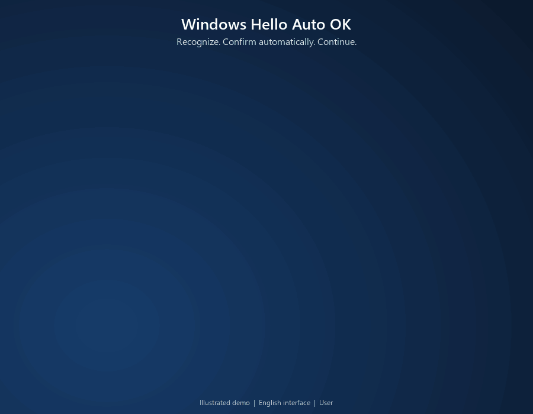

# Windows Hello Auto OK for Windhawk

A language-independent Windhawk mod that confirms the ready **OK** button in standard Windows Hello biometric dialogs across applications.



*Illustrated demo using an English interface and the display name User.*

## How it works

The mod runs inside the Windows copy of `CredentialUIBroker.exe` and monitors only its active foreground dialog. Losing focus resets the readiness timer. A window is invoked at most once during its lifetime. It requires a visible `BioFeedbackText` text control, one credential selector, and exactly one visible, enabled `OkButton` button. The selector can be the expanded `CredentialsListV2` list or the collapsed `ChooseAnotherOption` link. Any visible, enabled edit or password field prevents confirmation.

The ready state must persist for the configured delay and is checked again immediately before invoking the button through UI Automation. No keyboard or mouse input is broadcast.

**There are no language lists or caption comparisons.** The code never queries UI names, translated messages, user names, requesting application names or website addresses. Automation IDs are language-neutral. See Microsoft's [UI Automation testing documentation](https://learn.microsoft.com/en-us/windows/win32/winauto/uiauto-usefortesting).

This covers applications using the standard system dialog structure. It does not depend on any particular browser. An application with its own biometric interface, or a Windows version with different automation IDs, requires separate support.

## Install in Windhawk

1. Open Windhawk and choose **Create a New Mod**.
2. Replace the template with the complete contents of [windows-hello-auto-ok.wh.cpp](windows-hello-auto-ok.wh.cpp).
3. Save, compile and enable the mod.

The mod targets `CredentialUIBroker.exe` directly. It has no custom launcher,
requests no elevation, and creates no helper process. Windhawk must be able to
load the mod into the Windows credential broker. An installation that excludes
that process cannot run this mod.

Window events wake the worker. It sleeps without a polling timer when no broker
dialog is active, and checks readiness every 150 ms only while its dialog is
active. UI Automation runs on a dedicated MTA thread and caches only structural
properties. No credential text or biometric data is collected.

The mod creates no scheduled tasks, installs no service, and has no dependency on a separate helper executable. Disable or remove it through Windhawk.

## Settings

| Setting | Default | Meaning |
| --- | --- | --- |
| DelayMs | 350 | Required stable readiness period; clamped to 150-3000 ms. |

## Privacy

The source contains no account-specific defaults, personal paths, hostnames, saved credentials, or machine configuration. No account names, credential values, biometric data or interface text are read or logged. No diagnostic state or confirmation counter is written to local storage. The mod makes no network requests.

## Confirmation behavior

This removes Windows Hello's manual confirmation step. A program requesting
verification can be approved after Windows recognizes you while its Hello dialog
is active. Background dialogs are never confirmed automatically. Windows still
performs authentication, but enabling this mod removes the additional OK click.

## Validation and compatibility

This is an **experimental** release targeting the standard Windows Hello dialog. The structural guard is not a separate biometric-success API: Windows remains responsible for authentication, and the mod invokes a confirmation control exposed by that dialog.

Automated tests cover ready, missing, hidden, disabled, ambiguous and credential-input states, both credential-selector layouts, focus-loss timing resets, and the per-window one-invoke limit. Both x86 and x86-64 mod builds compile with Windhawk 1.7.3. The in-process runtime was smoke-tested with facial recognition on Windows 11 26H2 x64 and Windhawk 1.7.3. Windhawk 2.0 and other providers have not been interactively tested. Automated tests and compilation do not replace interactive verification across Windows versions, applications and authentication providers.

Run the structural tests on Windows with CMake and a C++ compiler:

```powershell
cmake -S . -B build
cmake --build build --config Release
ctest --test-dir build -C Release --output-on-failure
```

The CI workflow runs these guard tests. Install the single `.wh.cpp` file through Windhawk to compile the actual mod.

## License

[MIT](LICENSE).
